<picture>
  <source media="(prefers-color-scheme: dark)" srcset="assets/profile-hero-dark.svg">
  <source media="(prefers-color-scheme: light)" srcset="assets/profile-hero-light.svg">
  
</picture>

# Kerry Chia

**Data Computing and Applications · Renmin University of China · Class of 2029**

中国人民大学 · 数据计算及应用（数据智能方向）· 2029 届

[中文主页](https://yuzhou.ltd/) · [English website](https://kerrychia.site/) · [X](https://x.com/kerrychia999)

Exploring data, AI and blockchain through building and writing. / 以项目与写作探索数据、AI 和区块链，在构建中理解问题。

## 01 / About & roles · 关于我

- **RUChain 社长** — President, RUChain (Blockchain Association, Renmin University of China).
- **明理书院区块链创新实验室负责人** — Head, Blockchain Innovation Lab, Mingli College, Renmin University of China.

English role names are descriptive translations of the Chinese titles.

## 02 / Selected work · 成品项目

- **[wechat-publisher](https://github.com/KerryChia/wechat-publisher)** — 公众号文章精排、封面提示词与草稿管理，确认后提交发布。 / WeChat article formatting, cover prompts and draft management; publication submission requires confirmation.
- **[qqbot-task-notify](https://github.com/KerryChia/qqbot-task-notify)** — 通过 QQ 官方机器人私聊接口推送编码助手任务完成与等待提醒。 / Coding agent completion and waiting notifications through QQ’s official bot messaging API.
- **[ETHShanghai 2026 · 中文导读与深度研究](https://kerrychia.github.io/ethshanghai2026/)** — 非官方 ETHShanghai 活动中文导读，含逐场解读与 14 篇技术及实践研究。 / An unofficial Chinese ETHShanghai guide with session summaries and 14 research articles on technology, applications and community practice.

## 03 / In progress · 在研与招募

All three projects are in development and seeking collaborators. / 以下三项均在研，欢迎队友加入。

- **[Pactnova](https://github.com/KerryChia/Pactnova)** — 以虚拟 Agent 社区探索模拟交易中的授权边界与防御验证。 / A virtual agent community exploring authorization boundaries and defense validation in simulated transactions.
- **[REDTEAM](https://github.com/Fishman-free/REDTEAM)** — 在授权隔离与模拟资金场景研究智能体交易、支付安全及防御复核。 / Authorized research on agent transaction and payment safety, using isolated simulations and verifiable defense checks.
- **[quaiwei · 中文去 AI 味编辑 Skill](https://github.com/KerryChia/delete-ai)** — 面向中文写作的诊断与最小改写，保护事实、缺材料先追问，不是 AI 检测器。 / Chinese editing with diagnosis, minimal rewriting, fact protection and author clarification—not an AI detector.

## 04 / Connect · 联系

For project collaboration, research conversations or a thoughtful exchange, reach me by [email](mailto:yuzhoujia9@gmail.com), [X](https://x.com/kerrychia999) or [GitHub](https://github.com/KerryChia).

想交流项目、研究或学习，欢迎联系。更多文字与近况见 [中文主页](https://yuzhou.ltd/) / [English website](https://kerrychia.site/)。
